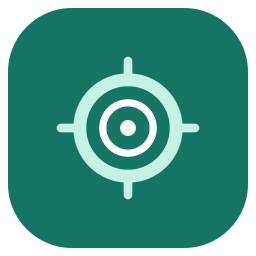

# 点控（DotCtrl）

<p align="center">
  
</p>

<p align="center">Android 8.0+ 离线连点与坐标脚本工具</p>

<p align="center">
  中文 ·
  <a href="./README_EN.md">English</a>
</p>

<p align="center">
  <a href="./LICENSE"></a>
  
  
</p>

点控（DotCtrl）是一个原生 Android 自动点击工具。它使用 Android 无障碍服务派发用户明确配置的点击、长按和滑动手势，并通过悬浮窗完成屏幕选点、脚本编辑和运行控制。

## 功能

- **单点连点**：配置点击或长按、固定间隔、点击次数或持续运行，并设置自动停止时限。
- **坐标脚本**：在浮窗中添加点击、长按、滑动和步骤延时，调整动作顺序并设置循环。
- **屏幕选点**：坐标按屏幕可用区域归一化保存，同时记录屏幕方向；方向变化时暂停，避免误点。
- **本机配置**：常用位置、点击模式和脚本只保存在设备本地，支持 JSON 导入和导出。
- **运行控制**：浮窗提供紧凑和展开状态、开始/停止、快速切换位置与模式，以及立即退出。
- **安全停止**：锁屏、受限界面、权限撤销或手势派发失败时停止并显示原因。

## 快速开始

环境要求：JDK 17、Android SDK Platform 35、Build Tools 35。

请让 `JAVA_HOME` 指向 JDK 17，并通过 `ANDROID_HOME` 或本地 `local.properties` 中的 `sdk.dir` 指定 Android SDK 路径。

```bash
./gradlew --no-daemon --no-configuration-cache :app:assembleDebug
./gradlew --no-daemon --no-configuration-cache :core:test :app:lintDebug
```

Debug APK 输出到 `app/build/outputs/apk/debug/app-debug.apk`。最低支持 Android 8.0（API 26）。正式版构建需要使用独立签名配置。

首次使用时：

1. 安装 APK，按页面引导开启“点控自动点击服务”和悬浮窗权限，分别用于派发配置的手势和显示选点与运行控制。
2. 在工作台选择“单点连点”或“坐标脚本”。
3. 配置位置、点击模式或脚本动作，然后从底部打开浮窗。
4. 在目标应用中确认选点，使用浮窗开始、暂停或停止任务。

## 验证

核心测试覆盖间隔、次数、循环、超时、停止、坐标换算、JSON 导入导出和错误文件。提交前建议运行：

```bash
./gradlew --no-daemon --no-configuration-cache :core:test :app:lintDebug :app:assembleDebug
```

分享 APK 前，建议在 Android 8.0+ 模拟器和实体设备上验证权限引导、单点与脚本运行、普通第三方应用中的点击、浮窗立即停止、方向变化、应用切换和权限撤销。

## 安全说明

- 仅供学习、研究与测试 · 请遵守法律法规及平台规则。
- 项目维护者不运营应用业务服务器。
- 无障碍服务用于派发用户明确配置的点击、长按和滑动，不读取目标应用的界面文字、节点或密码，也不录制其他应用中的真实触摸或屏幕。
- 配置仅保存在应用私有存储中；导出的 JSON 包含坐标和脚本时序，请按私人配置妥善保管。
- 请仅在获得授权的环境中使用，不得用于欺骗、作弊、侵犯隐私或规避安全机制。锁屏、安全界面、厂商限制或目标应用自身策略可能阻止手势派发，项目不承诺绕过这些限制。

## 开源许可

本项目依据 [GNU AGPL v3.0](./LICENSE)（`AGPL-3.0-only`）发布。
